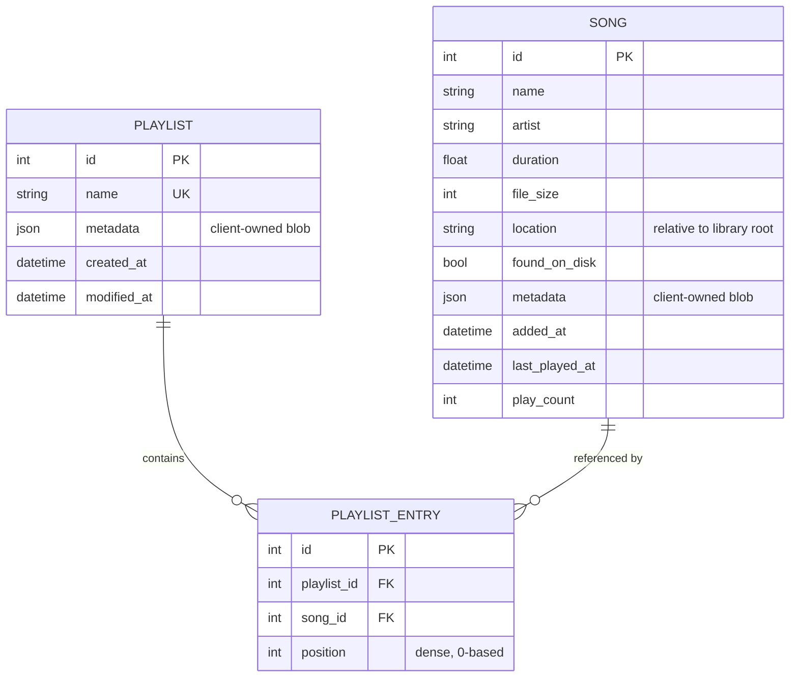
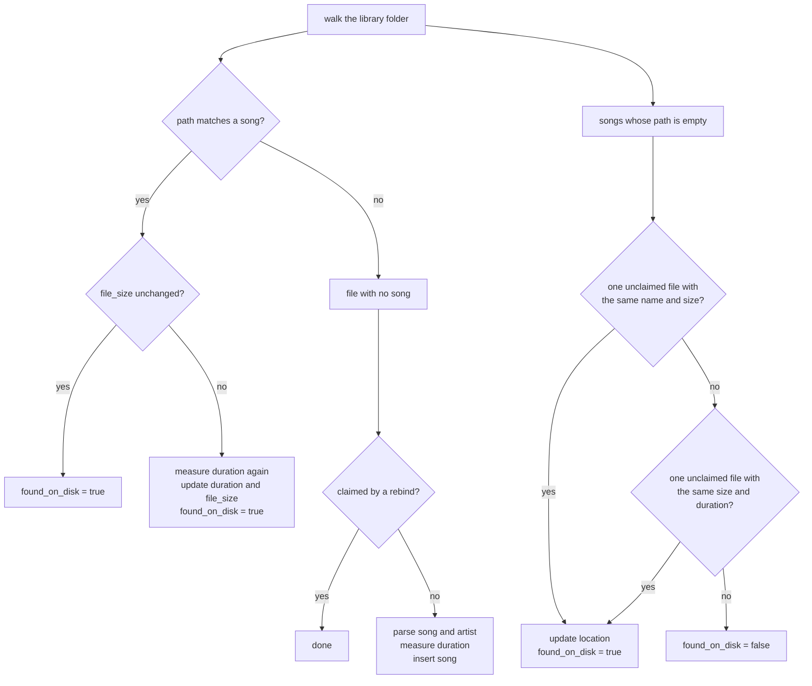

# core data

One sqlite database, in the library folder alongside the tracks it describes.

In addition, the backend will construct a pseudo playlist 'All Tracks' in memory. This contains all discovered songs. It is not writable.

Its id is the reserved 0, which is what a client passes to `get_playlist` or `play_playlist` to fetch or play it. Both the reserved id and the reserved name are refused by every write with `INVALID_ARGUMENT`.
Its entries are synthesised rather than read from `playlist_entry`, and each entry id is the negation of the song id. Real entry ids are positive, so an `All Tracks` entry id never names a stored row.

## Scanning

A scan walks the library folder and settles every song's `found_on_disk` flag. Run once, asynchronously, at startup

A missing track sets `found_on_disk` false and leaves the song record and its playlist entries in place. A later scan can set the flag back.
In the event of a missing track, attempt described recovery:
- Look for tracks with the same name and file size in the whole library. Match if only one exists
- Look for tracks with the same file size. For each match, open and check duration. If only 1 match exists with both duration and size equality, match it.
- Fail and update record to show it is not on disk anymore

Parse song names and artist using file names - `[song] ~~ [artist]`. Break at the last ` ~~ ` and take the first part as song name.
The separator is deliberately unusual so that a dash inside a title or an artist does not split the name in the wrong place.
If the separator is not in the filename, take the entire stem as song name and use artist 'unknown'
