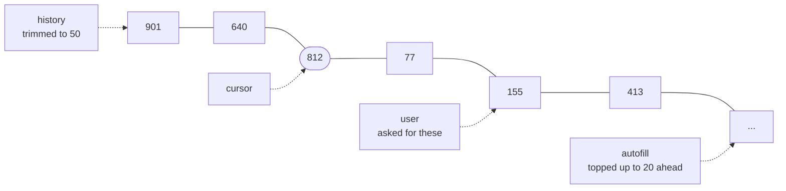
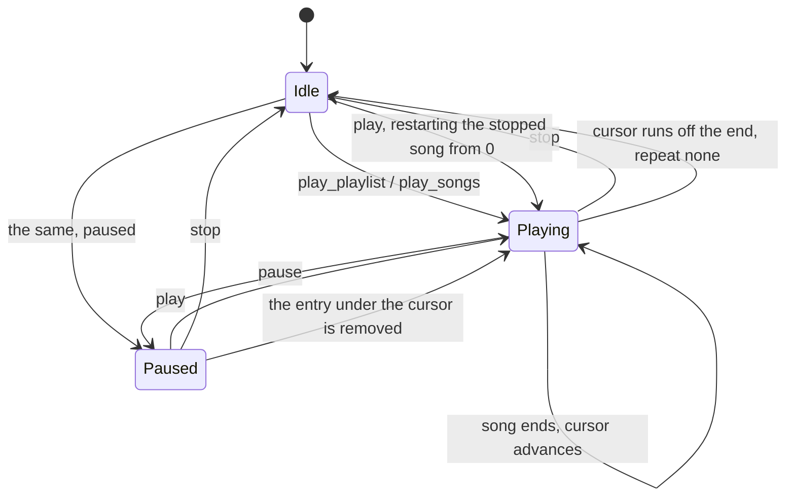

# core playback

## The queue

One ordered list of entries and a cursor. The cursor marks what is playing, entries behind it are the history, entries ahead are queued.

- Advancing moves the cursor. No entry is added or removed, though the entry passed becomes `user`.
- `queue_revision` moves on any edit to the queue
- Trimmed to 50 behind the cursor, refilled to 20 ahead. This triggers a queue revision
- A source is never copied in bulk. Starting playback seeds the queue with the chosen song alone, and the refill draws the rest on demand.

### Entries

An entry is a slot in the queue, not a song. The same song can sit in the queue several times, each occurrence its own entry.

- `entry_id` - a monotonic integer, allocated when the entry is created. Session-scoped: never written to the database, never reused after the entry leaves the queue, and gone on restart.
- `song_id` - what plays.
- `origin` - `user` if a client put it there, `autofill` if the refill drew it.

Clients address entries by `entry_id`. Nothing in the queue commands takes an index. An entry id keeps naming the same slot under a concurrent trim, refill or edit from another client, where an index would not.

The cursor is held internally as the `entry_id` of the playing entry, so inserts, moves and the history trim never have to repair it. `QueueState` exports `cursor` as an index.

### User entries stay contiguous

Ahead of the cursor the queue is always a run of `user` entries followed by a run of `autofill` entries. 

- An insert or a move names the entry to land after. Everything from the cursor up to and including that position becomes `user`.
- Inserting with no anchor lands at the boundary and promotes nothing.
- Moving with no anchor lands directly after the cursor.
- Insert and move address positions ahead of the cursor only. The history is removable but not a destination: an `after_entry_id` behind the cursor is `INVALID_ARGUMENT`.
- The refill appends past the tail, so it can never break the run.
- The cursor passing an entry makes it `user`, so the history is uniformly `user` whatever each entry started as. 
This is what lets the cursor move back onto a drawn entry without stranding an `autofill` entry ahead of a `user` one.

Only the autofill tail is disposable. Anything the user touched survives until it plays or they remove it.

## Sources

A queue is filled from a source: a nominated playlist, or the list of songs given to `play_songs`.
The playlist ids are snapshot when command is received.

A queue can also have no source. That is the state before the first `play_playlist` or `play_songs`, and the state after `queue_clear`, which drops the source permanently. 
Without a source the refill has nothing to draw from, so it does nothing whatever `repeat` says: the current song plays out and the session goes idle. 
Only a fresh `play_playlist` or `play_songs` gives the queue a source again.

## Repeat and shuffle

`repeat` defaults to `playlist`.

- `song` - the current song plays again on end. The cursor stays put.
- `playlist` - refill from the source whenever the queue runs short.
- `none` - no refill. Playback stops when the cursor runs off the end.

The refill tops the queue up to 20 entries ahead of the cursor and counts `user` entries toward that total.

`shuffle` decides how a refill picks. Off, it takes the source in order from where it left off. On, each song is drawn at random from the whole source, so repeats are possible.

Changing `shuffle` discards the autofill tail and draws it again the new way. The history, the current song and every `user` entry are left alone.

Shuffle is incompatible with no refill, since there is no defined end. Bind the two as shown:

- Setting `repeat` to `none` sets `shuffle` false.
- Setting `shuffle` true while `repeat` is `none` sets `repeat` to `playlist`.

## Transitions

`stop` keeps the queue and the cursor, so a following `play` restarts the same song from the beginning rather than resuming it. 
Removing the entry under the cursor while paused starts the entry that takes its place, which leaves the session playing.

Seeking clamps to the current song. Playing to the end is the only thing that advances the cursor unprompted.

A paused start seeds the queue and opens the song without starting the engine, and comes back paused at position 0.

## A song that will not play

A song that is missing or fails to decode emits `TrackFailed`, advances the cursor and tries the next one. Ten consecutive failures stop playback and leave the session idle.
