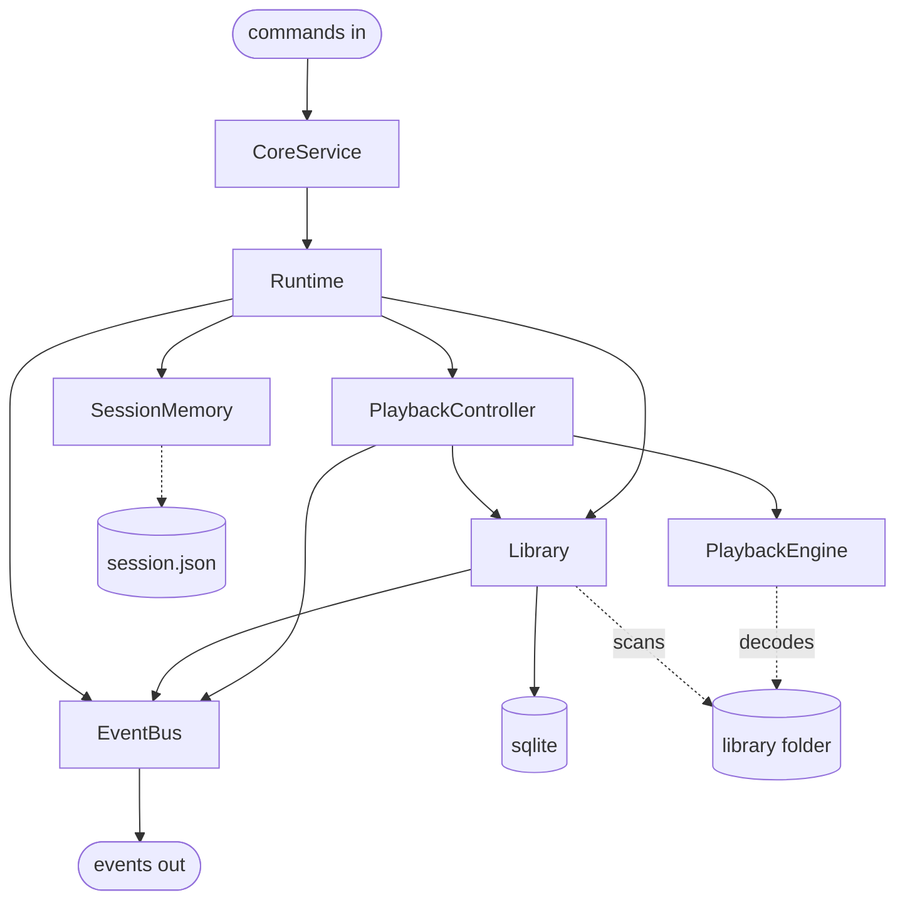
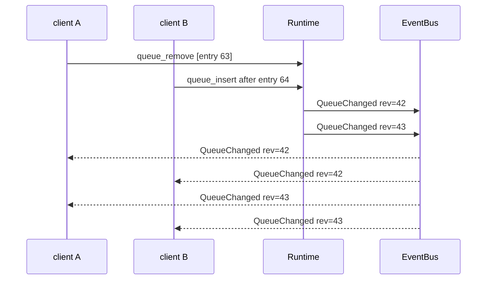

# core structure



- **CoreService** - one method per command in [client-protocol.md](client-protocol.md). The only surface a transport touches.
- **Runtime** - applies commands and engine reports one at a time. Ticks the heartbeat, and offers each beat to `SessionMemory`.
- **SessionMemory** - the session across runs. Restored on start, written debounced as the beat reports it changing.
- **PlaybackController** - the queue, the cursor, repeat and shuffle. See [core-playback.md](core-playback.md). It reads the library to expand a playlist into song ids, to look songs up, to count a play, and to turn a song into the file path it hands the engine.
- **Library** - songs, playlists, and the scanner. See [core-data.md](core-data.md).
- **PlaybackEngine** - decode and output. It is given a path and never consults the library itself.
- **EventBus** - holds `queue_revision` and `library_revision`, fans events to attached clients.

## Transports

A transport translates between the wire and `CoreService`. The bundled PyQt app calls it in-process; a websocket server is the same adapter over a socket.

Command arguments and event payloads are JSON-serializable on every path, in-process included.

## Ordering

Commands from every transport, and end-of-track reports from the engine thread, queue in the runtime and apply one at a time.



Both edits land, and both clients see both revisions. B named an entry, not a position, so A's removal ahead of it changed nothing about where B's songs belong.

The bus does not coalesce. Every event is fanned to every attached client as it is published, one `QueueChanged` per revision bump. 
Latest-only behaviour lives in the heartbeat, which attaches the queue when the revision has moved since the last heartbeat that carried it, and on every tenth beat regardless.

## Storage

sqlite through SQLAlchemy, in WAL, with writes confined to the runtime path. Schema history is alembic, configured by `core/alembic.ini` against `core/library/migrations`. 
`Library` upgrades the database to head as it opens it, so a deployed copy never needs the alembic CLI; the CLI still works for authoring revisions, with `alembic -c core/alembic.ini`.

## PlaybackEngine

The port isolating decode and audio output. `SoundDeviceEngine`, decoding through `soundfile` and writing to PortAudio, is the only implementation.

```python
class PlaybackEngine(ABC):
    def load(self, path: str) -> None: ...
    def play(self) -> None: ...
    def pause(self) -> None: ...
    def stop(self) -> None: ...
    def seek_to(self, seconds: float) -> None: ...
    def set_volume(self, level: float) -> None: ...
    def position(self) -> float: ...
    def duration(self) -> float: ...
    def is_playing(self) -> bool: ...
    def on_ended(self, callback: Callable[[], None]) -> None: ...
    def on_failed(self, callback: Callable[[str], None]) -> None: ...
    def close(self) -> None: ...
```

`on_ended` and `on_failed` fire on the engine's thread and post into the runtime. Core holds the volume level so it survives a track change.
