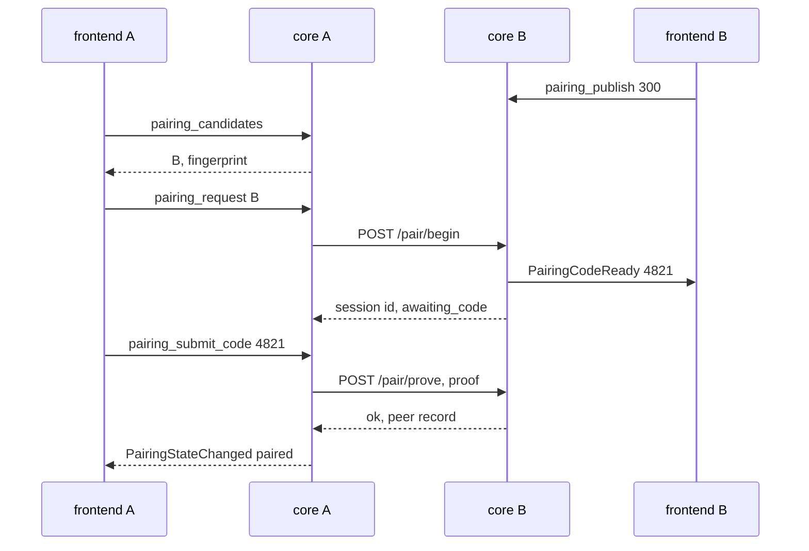
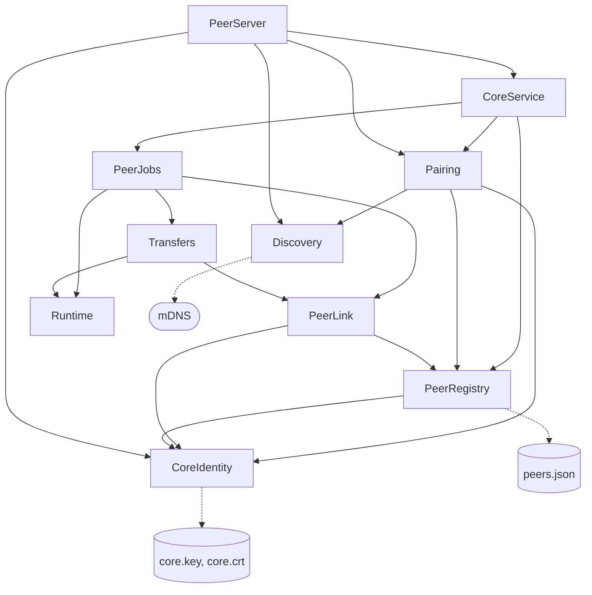

# Peer protocol

Protocol revision 3. Two cores find each other on a local network, become peers, and pull songs and playlists from each other.

Read [core.md](core.md) and [client-protocol.md](client-protocol.md).

## Vocabulary

- Core identity - the uuid a core mints on first run and keeps, together with the keypair and certificate that carry it.
- Peer authority - the keypair every core issues its certificate under. Both halves are constants in the source.
- Peer - another core this one trusts. Symmetric: either side may read and pull from the other.
- Pairing - one-time exchange to establish a peer relationship.
- Visibility window - the bounded period during which a core answers pairing.
- Job - a unit of peer work a client started and cannot wait on. Carries an id and reports by events.
- Fetch - a job that pulls library data from one peer and merges it into this core.
- Plan - what a fetch settles before it moves any bytes: the rows to write and the files to pull.
- Transfer - one track file moving from a peer to this core.
- Track uuid - the identity of a track.
- Playlist uuid - the identity of a playlist.

## Listeners

| Listener | Carries                            | Default port | Default state | mDNS service            |
|----------|------------------------------------|--------------|---------------|-------------------------|
| client   | the client protocol, over a socket | 47821        | closed        | `_deltamusic._tcp`      |
| peer     | this document                      | 47822        | open          | `_deltamusic-peer._tcp` |

Both require a trusted core certificate. The client listener stays closed until a user opens it. 
A bundled frontend bypasses both listeners.

## Origin

Every attachment carries an `origin`, either `local` or `network`, set by the transport that accepted it and held outside the envelope.

A `network` attachment cannot reach the pairing surface, for dispatch and for delivery both.

- The `pairing_*` commands and `peer_forget` are `local` only.
- The whole `Pairing*` event family is `local` only, since pairing emits the code for a frontend to display.
- A `network` caller aiming at a local-only method gets `INVALID_ARGUMENT` and the text of an unknown method, the same as a typo.

## Core identity

- On first run a core mints an EC P-256 keypair and a certificate carrying its uuid and display name, issued under the peer authority, written to `config/core.key` and `config/core.crt`.
- Certificates are long lived, ten years. Pinning is on the SHA-256 of the DER `SubjectPublicKeyInfo` rather than the whole certificate, so a reissued certificate keeps the identity. 
That fingerprint, hex encoded, is what appears in mDNS, in a pairing proof, and in `config/peers.json`.
- The private key sits on disk with ordinary file permissions.
- The uuid is the `UID` of the certificate's subject and the display name is its `CN`, so a presented certificate carries both before anything is asked of the core behind it.

### The peer authority

`AUTHORITY_SCALAR` is a constant in the source, the private half of an EC P-256 keypair. Every core derives the same key from it and builds the same authority certificate over a fixed subject, serial and validity window, so nothing is shipped as a certificate blob and no core needs to be issued one.

A core signs its own certificate with that key and holds the authority certificate as its whole trust store.

- Holding a certificate under the authority establishes nothing, since the private half is published and anyone can mint one.
- It is there because a TLS stack verifies a presented certificate against a trust store and drops the connection before the application sees it, so a chain that verifies is what carries a certificate as far as a route.
- Identity is the fingerprint, and what a fingerprint is worth is settled under Trust.

## Trust

A presented certificate is trusted when its fingerprint has a record in `config/peers.json`.

Verification is done by the application:

1. Both listeners set `CERT_OPTIONAL`, over a trust store holding the peer authority alone.
2. The route reads the peer certificate with `getpeercert(binary_form=True)`.
3. The two pairing routes accept an untrusted certificate while the window is open. Every other route requires a record.
4. Anything else is answered `UNTRUSTED_PEER`, and the connection is dropped behind the answer.

`config/peers.json` holds the core's own id and name, and one record per peer:

```json
{
  "core": {"id": "9e1c...", "name": "workshop"},
  "peers": [
    {
      "id": "4a77...", "name": "living room", "fingerprint": "b3c9...",
      "address": "192.168.1.24", "port": 47822,
      "paired_at": "2026-08-11T09:14:02.000Z", "last_seen_at": "2026-08-11T18:40:11.000Z"
    },
    {
      "id": "d052...", "name": "kitchen", "fingerprint": "77af...",
      "address": "192.168.1.31", "port": 47822,
      "paired_at": "2026-08-11T11:02:47.000Z", "last_seen_at": "2026-08-11T18:39:50.000Z"
    }
  ]
}
```

An inbound connection carries the address it came from and no listening port, so a record written from one holds the default port until discovery or an outbound attempt corrects it. 
A handshake against a record takes the display name the certificate carries and the address it answered at.

## Discovery

mDNS and DNS-SD, browsed and advertised continuously while the listener is up. One service, with `pairing` flipping. 
The service instance is named by the core's uuid, so a rename moves the display name in the TXT record and leaves the instance where it was. The peer service's TXT record carries what a candidate list needs:

| Key       | Meaning                    |
|-----------|----------------------------|
| `id`      | core uuid                  |
| `name`    | display name               |
| `fp`      | SPKI fingerprint, hex      |
| `pairing` | `open` or `closed`         |
| `v`       | peer protocol version      |

`pairing_candidates` lists what discovery found once the peers are taken out.

`address` in a peer record is a cache for a first attempt. When it fails, the peer is resolved by `id` off mDNS before the attempt is called a failure. 
An `address` a command names may carry a port after a colon, and stands in for discovery rather than beside it.

## Pairing

Pairing is how two cores become peers. `pairing_publish` opens the window for at most `visibility_seconds` and flips `pairing=open`. 
It closes on `pairing_conceal`, on expiry, or on a successful pairing. Both ends drive it from a local frontend: the responder opens the window and reads the code out, the initiator submits it.



The exchange:

1. The responder opens its window, and the initiator picks it out of `pairing_candidates`.
2. `pairing_request` posts `/pair/begin`.
3. The responder draws a four digit code from `secrets`, emits `PairingCodeReady`, and answers with a session id.
4. The user reads the code across, and `pairing_submit_code` posts `/pair/prove` carrying `HMAC-SHA256(key=code, message=fingerprint_initiator || fingerprint_responder)`, over the raw fingerprint bytes in that order.
5. The responder recomputes the proof under `compare_digest`.
6. Both sides write a peer record.

Each side takes the other's uuid and display name from the certificate it was handed. 
An inbound connection names no listening port, so the responder takes the initiator's off mDNS, and holds the default until discovery surfaces it. 
The initiator takes the responder's port from the answer to `/pair/prove`. 
A candidate's `fp` is a claim, so a core answering under another key is `UNTRUSTED_PEER` before a code is drawn.

Limits:

- Three attempts. The fourth destroys the code and the session, and the user starts again from `pairing_request`.
- A session dies with the window, or after 120 seconds idle, whichever comes first. Each message on a session pushes that clock forward.
- Eight sessions at once. A window holding that many answers `PAIRING_CLOSED` until one dies.

A proof that does not verify is answered `PAIRING_REFUSED`, carrying `attempts_left` in the error detail, and `PairingStateChanged` fires with `refused` on both sides. 
The initiator takes the count the responder reported, since the responder is the side holding the code.

Re-establishing later is the same mutual handshake with no code. `peer_forget` removes the local record.

## Peer link

Mutual TLS over HTTP/1.1.

- Peer reads are `GET`, pairing is `POST`.
- Track bytes are a `GET` with `Range`.
- Bodies are JSON, and `/songs` and `/playlists` are served under `Content-Encoding: gzip`.
- The version is in the path and in the TXT record, so a core speaking another revision finds no route and is answered `NOT_FOUND`.

| Route                      | Purpose                                            |
|----------------------------|----------------------------------------------------|
| `POST /peer/3/pair/begin`  | open a pairing session                             |
| `POST /peer/3/pair/prove`  | submit a proof                                     |
| `GET /peer/3/hello`        | core id, name, version, `library_revision`, counts |
| `GET /peer/3/songs`        | every song, whole                                  |
| `GET /peer/3/playlists`    | every playlist, entries as track uuids             |
| `GET /peer/3/track/{uuid}` | the file                                           |

A refusal carries the client protocol's error object, and its code decides the status: `INVALID_ARGUMENT` is 400, `UNTRUSTED_PEER` and `PAIRING_REFUSED` are 403, `NOT_FOUND` is 404, `PAIRING_CLOSED` is 409, and the rest are 500. 
The connection closes behind a refusal, since a body the answering end did not read leaves nothing to reuse. 
A `POST` body is JSON, at most 64 KiB, and every route needs a certificate whether or not it needs trust.

`hello` answers:

```json
{"id": "9e1c...", "name": "workshop", "version": 3, "library_revision": 418, "songs": 1204, "playlists": 7}
```

The pairing routes answer:

```json
{"session_id": "7f3c1a09b25e4d68", "state": "awaiting_code"}

{"state": "paired", "core": {"id": "9e1c...", "name": "workshop", "port": 47822}}
```

`/pair/begin` takes an empty object, since the initiator is read off its certificate. `/pair/prove` takes `{"session_id", "proof"}`, the proof hex encoded.

A peer song omits ids and play counts:

```json
{
  "songs": [
    {
      "uuid": "b81f2c66-...", "name": "Slow Burn Interlude", "artist": "Kestrel Field",
      "duration": 252.0, "file_size": 6291456,
      "location": "2026/03/Slow Burn Interlude - Kestrel Field.opus", "metadata": {},
      "available": true
    }
  ]
}
```

`available` is the sender's `found_on_disk`. A song carrying it false is a row the sender can describe and cannot serve bytes for.

A peer playlist omits ids and entry ids, and carries its membership as an ordered list of track uuids:

```json
{
  "playlists": [
    {
      "uuid": "6f3d1b04-...", "name": "Late night", "metadata": {},
      "created_at": "2026-01-02T19:44:00.000Z", "modified_at": "2026-07-30T08:12:04.000Z",
      "songs": ["b81f2c66-...", "0c47ae1d-...", "b81f2c66-..."]
    }
  ]
}
```

Position is the index in `songs`, and a repeated uuid is a duplicate entry. `All Tracks` is assembled rather than stored, so it is not served.

## UUID

Every song carries a `uuid`, minted when the track is first discovered and preserved from then on, through relocation, through re-encoding, and across a transfer. Every playlist carries one, minted when it is created and preserved the same way.

A playlist has no file, so its uuid lives in the database alone. `All Tracks` has none.

### Stamping

- The uuid is written into the file's tags, as `DELTAMUSIC_UUID` in vorbis comments for opus, ogg and flac, and as `TXXX:DELTAMUSIC_UUID` for mp3.
- It is read always and written where the container takes it. wav and aiff are skipped and live in the database alone.
- The database stays authoritative
- A lost track is matched on its tag ahead of the name-and-size and size-and-duration heuristics.

| A scanned file                                       | What happens                                          |
|------------------------------------------------------|-------------------------------------------------------|
| carries a uuid whose row is missing from disk        | rebind that row: relocation and healing               |
| carries a uuid whose row is present on disk          | a copy. Insert with a fresh uuid and restamp the copy |
| shares a uuid with another new file in the same scan | first wins, the second is treated as a copy           |
| carries no uuid                                      | mint, and stamp if the container takes it             |

Two orderings:

- Stamping changes size and mtime, so the recorded `file_size` is read after the write.
- A received file is verified before it is stamped, since the write invalidates the sender's digest.

The digest is per-transfer integrity, not track identity.

## Fetching

A fetch pulls library data from one peer and merges it into this core. `peer_fetch_songs` names track uuids, `peer_fetch_playlists` names playlist uuids, and either naming nothing takes everything of that kind the peer carries. All of them settle a plan, write rows, then queue the files.

### Planning

A fetch reads `/songs`, and `/playlists` as well when it names playlists, and settles three sets:

- the playlists to merge, being the named playlist uuids the peer carries;
- the songs, being the named track uuids plus every track uuid in a named playlist. The ones with no row here are the rows to insert;
- the files to pull, being the songs the peer reports `available` that this core does not hold on disk, whether their row is arriving now or was already here.

The named uuids of a fetch that named none are everything the peer's answer carries, so the plan is settled from the one read either way and a whole-library copy needs no listing first.

A named uuid the peer does not carry is dropped from the plan and listed in the result. A fetch whose plan is empty finishes as one whose plan was satisfied.

A plan is settled only when its files fit. The sizes of the files it would pull are summed with the bytes the transfer queue has still to move, and measured against the free space of the library folder's filesystem less `transfer_space_reserve_bytes`. A plan that does not fit is refused with `INSUFFICIENT_SPACE` before any row is written.

### Rows first

Rows are written before any file moves, so a playlist is whole and playable as far as its tracks allow while the rest are still arriving. Writing them moves `library_revision` and emits `LibraryChanged` like any other library write.

Songs are merged 400 at a time and each playlist is merged on its own, so a whole-library pull writes as a run of batches rather than one. Every batch carries its own `LibraryChanged`.

An inserted song carries the sender's uuid, name, artist, duration, file size and metadata, a null `location`, and `found_on_disk` false. Its `location` is set when its file lands, since where a file lands is not known until then.

A song already known here takes the sender's name, artist and metadata too, the same as a known playlist does. What stays local is what describes this copy rather than the song: `added_at`, `play_count`, `last_played_at`, `location` and `found_on_disk`. `duration` and `file_size` stay with them while a file is held, and are taken from the sender while none is.

### Merging playlists

A playlist merges by uuid.

- Unknown - create it, with the sender's uuid, name, metadata, `created_at` and `modified_at`.
- Known - keep the local row, take the sender's name, metadata and `modified_at`, and replace the entry list with the sender's, in the sender's order.

Replacing the entry list drops the local entries the sender's list does not carry, and that is the only thing a fetch removes. No song row, file, play count, or entry in any other playlist is touched by it. A track that leaves a playlist stays in the library.

An arriving name that collides with a different playlist uuid is suffixed, and so is one that collides with the reserved name `All Tracks`.

### Transferring

Files move off one queue held by the core, ordered by arrival. `max_concurrent_transfers` transfers run at once and the rest wait.

- A transfer is named by track uuid, so two fetches asking for the same track share one transfer and both report it.
- A dropped transfer is retried twice, resuming by `Range`. Beyond that it is given up and counted against every fetch waiting on it, which carries on with the rest of its plan.
- Cancelling a fetch drops its queued transfers and stops the ones running for it alone. Rows already written stay.

The sender:

- streams the file from `GET /peer/3/track/{uuid}` with `Accept-Ranges: bytes`;
- sends `X-DeltaMusic-Digest`, the SHA-256 of the whole file, so a resumed transfer still verifies at the end.

The receiver:

1. writes to a `.part` file beside the destination, which is the sender's relative `location` under the local library folder, suffixed on collision;
2. resumes by `Range` on a retry;
3. verifies the digest;
4. stamps the uuid into the file;
5. moves the file into place and writes the location and the size it measures onto the row.

The destination is taken from the sender's `location` with anything that would climb out of the library folder dropped, so a peer names a path under this core's folder and nowhere else. 
A retry resumes only when the sender answers `206`, and an attempt that dies without writing anything throws the resume point away, so a sender that will not serve the range is pulled again from nothing. 
A sender carrying no digest is measured against the `file_size` it advertised instead. A file that does not verify is deleted and pulled again, which spends an attempt.

A row whose file is on disk is never queued for transfer, so an arriving file always lands on a row with `found_on_disk` false, whether that row was inserted by this fetch or lost earlier. Its playlist entries and its play count survive either way. 
A landing whose location another row took while the transfer ran leaves the file on disk and the row without a location, for the uuid tag match to bind on the next scan.

### Locations

`location` is nullable and unique. Null is a song no file has ever been placed for.

- The scanner ignores `.part`.
- The name-and-size and size-and-duration recovery heuristics skip rows with a null location, since there is nothing to recover.
- The uuid tag match does not skip them, so a track copied in by hand binds to the row a failed transfer left behind.

An insertion skips a location already present. 
`apply_scan_plan` computes its plan off-thread from an earlier snapshot and inserts every unclaimed file, so a file that appears between snapshot and apply would otherwise be inserted a second time, under a second uuid. 
A large pull lands in that window, as does the acquisition module finishing a recording.

## Client protocol additions

The peer surface of the client protocol. The version, the song and playlist shapes, and `get_songs_by_uuid` are in [client-protocol.md](client-protocol.md).

### Jobs

The listing and fetching commands validate, start work on a thread, and return a job id at once. Results and failures arrive as events.

Job ids are strings, last only as long as the run of core, and must not be stored.

A job carries a `kind` of `list_songs`, `list_playlists`, `fetch_songs` or `fetch_playlists`, and a `state`:

| State       | Meaning                                                |
|-------------|--------------------------------------------------------|
| `planning`  | reading from the peer, before anything is written      |
| `running`   | rows are written and transfers are queued or in flight |
| `finished`  | every item in the plan was satisfied or given up       |
| `failed`    | no plan was settled, so nothing was written            |
| `cancelled` | stopped by `peer_job_cancel`                           |

A fetch that could not pull some of its files still finishes, and names them in its result. `PeerJobFailed` is for a job that got no further than planning.

A listing job reads and answers, so it goes from `planning` to `finished` and reports no progress.

### Pairing, `local` only

| Command               | Params                 | Result                   |
|-----------------------|------------------------|--------------------------|
| `pairing_status`      |                        | window state and expiry  |
| `pairing_publish`     | `seconds`              | window state             |
| `pairing_conceal`     |                        | window state             |
| `pairing_candidates`  |                        | `{candidates}` from mDNS |
| `pairing_request`     | `core_id`, `address`   | `{session_id, state}`    |
| `pairing_submit_code` | `session_id`, `code`   | `{state, attempts_left}` |
| `pairing_cancel`      | `session_id`           |                          |
| `peer_forget`         | `peer_id`              |                          |

- `seconds` is clamped to `visibility_seconds`. `address` is optional and only for reaching a core mDNS did not surface.
- `state` is `awaiting_code`, `paired`, `refused` or `cancelled`.
- `pairing_status` and the two window commands answer `{open, expires_at}`, where `expires_at` is null while the window is shut.
- `pairing_cancel` on a session that is unknown or already settled does nothing and succeeds.

`pairing_request` and `pairing_submit_code` cross the network before they answer, so each takes a round trip.

### Peers, either origin

| Command                | Params              | Result     |
|------------------------|---------------------|------------|
| `peer_list`            |                     | `{peers}`  |
| `peer_list_songs`      | `peer_id`           | `{job_id}` |
| `peer_list_playlists`  | `peer_id`           | `{job_id}` |
| `peer_fetch_songs`     | `peer_id`, `uuids?` | `{job_id}` |
| `peer_fetch_playlists` | `peer_id`, `uuids?` | `{job_id}` |
| `peer_jobs`            |                     | `{jobs}`   |
| `peer_job_cancel`      | `job_id`            |            |

- `uuids` omitted takes everything the peer carries of that kind, so a whole-library copy is one call. An empty list is `INVALID_ARGUMENT`, since it asks for nothing by naming nothing.
- A uuid the peer does not carry is reported in the result rather than refused, since what a peer holds is only known once it answers.
- `peer_jobs` gives every job of this run, each with its `job_id`, `kind`, `peer_id`, `state` and latest counts, so a client attaching part way through sees what is already moving.
- `peer_job_cancel` on an id that is unknown or already settled does nothing and succeeds.
- A listing job reads the peer's songs whichever kind it is, since a playlist's sizes are measured off them.

A listing job's result is the peer's library as the peer serves it, measured against this one. `list_songs` carries `songs`, `list_playlists` carries `playlists`:

```json
{
  "songs": [{"uuid": "b81f2c66-...", "available": true, "held": false}],
  "playlists": [{"uuid": "6f3d1b04-...", "songs": ["b81f2c66-..."], "songs_held": 30, "songs_missing": 11, "bytes_missing": 61847552}]
}
```

- Each entry is the peer song or peer playlist shape, whole, with these fields added.
- `held` is whether this core has that track's file on disk.
- `songs_held` and `songs_missing` count the playlist's entries by that same measure, duplicates included.
- `bytes_missing` totals the file sizes of the missing entries the peer reports `available`, so it is what fetching that playlist would move.

A fetch job's result is what the merge did:

```json
{
  "playlists_created": 1, "playlists_updated": 2, "entries_dropped": 4,
  "songs_inserted": 11, "songs_updated": 32,
  "files_received": 12, "bytes_received": 61847552,
  "unknown": ["3f0c9a55-..."],
  "given_up": [{"uuid": "9ab1c204-...", "error": "TRANSFER_FAILED"}]
}
```

- `songs_inserted` counts rows written by this fetch, and `songs_updated` counts rows already here that took the sender's fields.
- `entries_dropped` counts playlist entries the merge removed.
- `unknown` lists the named uuids the peer does not carry.
- `given_up` lists the files that ran out of retries.

### Events

| Type                       | Payload                                | Origin |
|----------------------------|----------------------------------------|--------|
| `PairingWindowChanged`     | `open`, `expires_at`                   | local  |
| `PairingCandidatesChanged` | `candidates`                           | local  |
| `PairingCodeReady`         | `session_id`, `code`, `peer_name`      | local  |
| `PairingStateChanged`      | `session_id`, `state`, `attempts_left` | local  |
| `PeerChanged`              | `peers`                                | either |
| `PeerJobProgress`          | `job_id`, `kind`, `state`, counts      | either |
| `PeerJobFinished`          | `job_id`, `kind`, `state`, `result`    | either |
| `PeerJobFailed`            | `job_id`, `kind`, `error`              | either |

`PeerJobFinished` carries the `state` a job settled in, so it covers a cancelled job as well as a satisfied one, and its result is what the merge did before it stopped. 
`PeerJobFailed` is the only terminal event that carries no result, since a job that failed wrote nothing.

`PeerChanged` covers a pairing completing, a peer being forgotten, and a peer's name or address changing. 
`last_seen_at` is written on every handshake and carries no event of its own, so serving a pull leaves a client's peer list still.

`PeerJobProgress` fires first when the plan settles, before any bytes move, and then no more than once a second per job:

```json
{
  "job_id": "j-7", "kind": "fetch_playlists", "state": "running",
  "items_done": 12, "items_total": 40,
  "bytes_done": 60817408, "bytes_total": 214958080,
  "active": [{"uuid": "b81f2c66-...", "bytes_done": 1048576, "bytes_total": 6291456}]
}
```

- An item is one file in the plan, and a given-up file is done. `bytes_total` is the plan's file sizes summed, so it is settled from the first event.
- `active` is the transfers running for this job, up to `max_concurrent_transfers` of them. A job whose transfers are all still queued behind another job's carries an empty `active`.

### Errors

| Code                 | Meaning                                                        |
|----------------------|----------------------------------------------------------------|
| `PEER_UNKNOWN`       | No such peer                                                   |
| `PEER_UNREACHABLE`   | The peer did not answer, at its cached address or by discovery |
| `PAIRING_CLOSED`     | The target is not accepting pairing                            |
| `PAIRING_REFUSED`    | The proof did not verify, or the attempts are spent            |
| `UNTRUSTED_PEER`     | No record pins that certificate                                |
| `TRANSFER_FAILED`    | Truncated, or the digest did not match                         |
| `INSUFFICIENT_SPACE` | The files a plan would pull do not fit in the library folder   |

## Threads

The peer side runs beside the runtime rather than on it.

- The listener answers each request on its own thread, jobs run one thread each, and transfers run `max_concurrent_transfers` of them.
- A command that crosses the network answers on the thread that called it, so a round trip never holds the runtime and playback carries on under it.
- Every library write is marshalled onto the runtime, which stays the only thread that writes.
- A peer event is published on whichever of those threads learned it.

## Configuration

Flat fields on `Config`

| Field                          | Default      |
|--------------------------------|--------------|
| `peer_enabled`                 | `true`       |
| `peer_port`                    | `47822`      |
| `core_name`                    | the hostname |
| `visibility_seconds`           | `300`        |
| `max_concurrent_transfers`     | `2`          |
| `transfer_space_reserve_bytes` | `1073741824` |
| `remote_control_enabled`       | `false`      |
| `remote_control_port`          | `47821`      |

## Where this lives



- CoreIdentity - the keypair, the certificate carrying this core's uuid and display name, and the fingerprint both ends pin on.
- PeerRegistry - `peers.json`, and the only thing that decides whether a certificate is trusted, which it does by finding the record that pins its fingerprint.
- Discovery - advertises one service and browses for others. Owns the TXT record and the visibility flag.
- Pairing - windows, sessions, codes and proofs, and both ends of the exchange. It draws the candidate list, which is what discovery found once the peers are taken out.
- PeerLink - the outbound half: one peer, mutual TLS, the routes above.
- PeerServer - the inbound half. Answers the routes by asking `CoreService` for library data, and owns the lifecycle of the listener, discovery and the pairing window.
- PeerJobs - the job table and the threads under it. It settles a plan, writes rows and merges playlists through the library on the runtime thread, and hands the files to `Transfers`.
- Transfers - the transfer queue and the threads under it. One entry per track file, deduplicated by uuid across jobs, capped by `max_concurrent_transfers`. It writes each landing onto its row the same way.

`CoreService` is handed the peer components as one value, so a core built with peering off carries none of them and every peer method reads as unknown.
